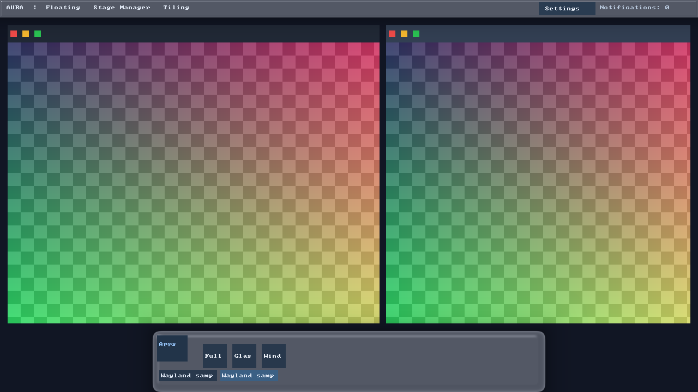
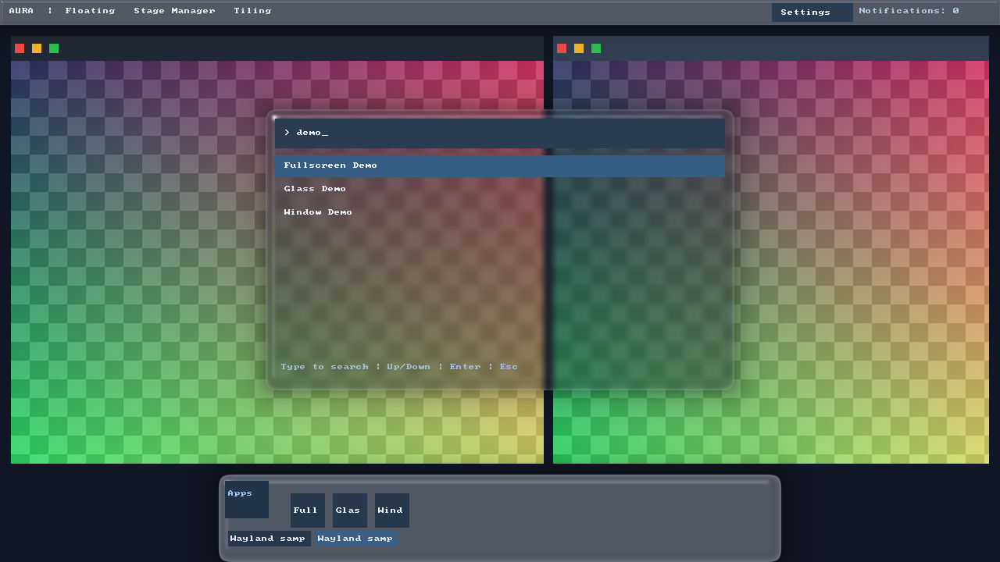
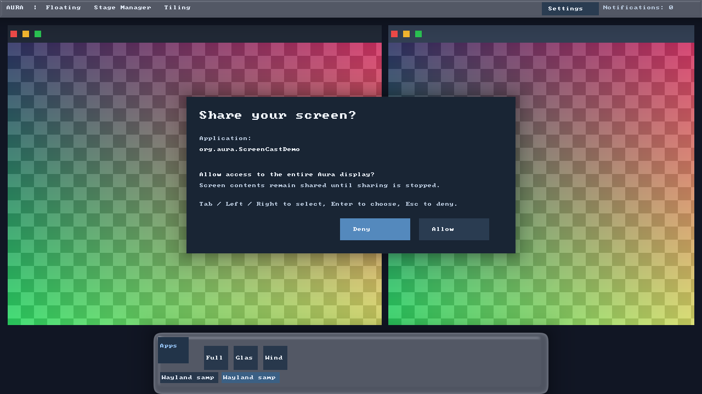
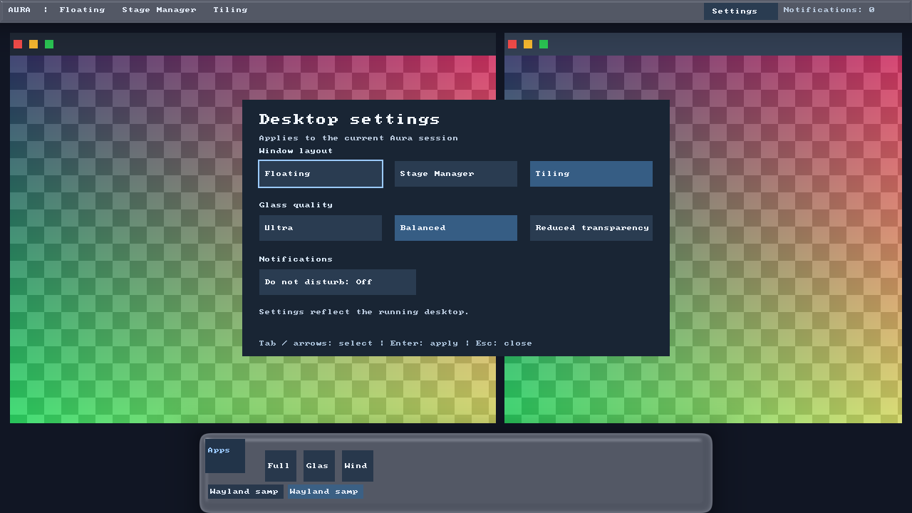

# Aura Desktop Environment

Aura DE is an experimental Linux desktop written in Rust, with a Wayland compositor and a graphical shell. The workspace separates pure layout/animation models, rendering, compositor, shell, launcher, and session management into six crates.

This is a nested, single-output development desktop. It includes Wayland client lifecycle and input handling, negotiated server-side window controls, fullscreen policy, layer-shell panels and an XDG application launcher. The launcher and Dock refresh installed applications automatically, support terminal commands and D-Bus activation, and magnify Dock app tiles under the pointer. Glass rendering retains the scene/blur textures and skips unchanged frames. Session controls include notification actions and a settings panel for window layout, glass quality and Do Not Disturb. ScreenCast exports an approved monitor source through real PipeWire buffers; its integration gate and current limits are recorded in [implementation status](docs/implementation-status.md).

This is development software, with no claim of a working native DRM/KMS session. ScreenCast is limited to a single monitor, hidden cursor and fixed-size SDR RGBA frames, at most 4096 pixels per axis. Resizing ends the stream and requires fresh selection/consent. Hardware performance, zero-copy capture, HDR and multioutput are not established.

## Screenshots

Captured from a running nested session with Mesa software rendering. The windows and launcher entries shown here are development samples.

**Tiled windows, menu bar, and Dock**



**Application search with a glass backdrop**



**Screen sharing consent, with Deny selected by default**



**Desktop layout, glass quality, and notification settings**



## Build on Linux

Rust **1.99.1** is pinned in `rust-toolchain.toml`. Install Rust with rustup using its official installer, preserving TLS/checksum verification, then install the native packages needed by the selected backend:

```bash
# Debian/Ubuntu, from the repository root:
sudo bash scripts/install-deps.sh --testing
# Optional DRM/input/session/PipeWire build dependencies:
sudo bash scripts/install-deps.sh --native --testing

cargo build --workspace --locked
```

The installer includes PipeWire development headers and libclang for the Rust bindings. `--testing` adds the PipeWire daemon/modules/tools, Xvfb, software GPU drivers and input/desktop utilities used by integration checks. These checks create private display, D-Bus and PipeWire instances; they do not replace the host desktop's services.

The default development backend is nested winit. For a user-local dependency sysroot, set `AURA_SYSROOT` and source `scripts/dev-env.sh` before Cargo commands; ordinary system installations do not require this helper.

On Debian 13 without root access, `bash scripts/install-deps-user.sh --native --testing` downloads signed packages and extracts a workspace sysroot. Activate it with `export AURA_SYSROOT=/workspace/.cloud-setup/sysroot; source scripts/dev-env.sh`.

`Cargo.lock` is retained for this application workspace. Refresh dependencies deliberately and review changes rather than resolving new dependency versions during every setup.

## Validate

```bash
python3 scripts/verify_workspace.py
python3 -m unittest discover -s scripts/tests -p test_xvfb.py -v
cargo fmt --all -- --check
cargo test -p aura-core --locked
cargo check --workspace --all-targets --locked
cargo clippy --workspace --all-targets --locked -- -D warnings
cargo test --workspace --locked

# Build actual binaries/examples before scripts using --no-build:
cargo build --workspace --bins --examples --locked
python3 scripts/smoke_nested.py --no-build --software
python3 scripts/integration_desktop.py --no-build --software
python3 scripts/session_smoke.py --no-build
python3 scripts/launcher_dock_smoke.py --no-build
python3 scripts/desktop_controls_smoke.py --no-build
python3 scripts/window_render_smoke.py --no-build
python3 crates/aura-session/tests/pipewire_roundtrip.py
python3 scripts/screencast_smoke.py --no-build
```

The Python structure check verifies manifests and source paths only. Rust tests exercise the implementation. The nested smoke script runs a real Wayland SHM client and waits for configure/frame events; it creates Xvfb when no host display is available. The launcher/Dock check exercises live install/edit/remove updates, terminal argument handling, real D-Bus activation/fallback and magnified click targets; see [application launching](docs/application-launching.md). The desktop-controls check exercises notification action/close signals, acknowledged settings changes and keyboard layout shortcuts on a private bus/display. The window-render check verifies idle counters, glass-cache invalidation and real window-control input. The PipeWire fixture checks exact transported pixels; the separate ScreenCast check covers the actual compositor/consent/PipeWire path. See [capture and driver checks](docs/screencast.md) for explicit GPU tests and the meaning of each result.

Mesa software rendering can validate the nested development path, but cannot validate a hardware DRM/KMS session or measure hardware performance. Xvfb startup is checked through an actual X11 connection, with stderr retained under `target/xvfb-logs`. Each graphical script retains its logs under `target`; the window-render and ScreenCast checks also save `results.json` evidence.

## Nested development

Start the compositor inside an existing X11 or Wayland desktop:

```bash
cargo run --locked -p aura-compositor -- --backend winit --socket wayland-aura-0
```

In another terminal with the same `XDG_RUNTIME_DIR`, connect the clients to Aura's socket:

```bash
AURA_COMPOSITOR_GLASS=1 WAYLAND_DISPLAY=wayland-aura-0 cargo run --locked -p aura-shell
AURA_COMPOSITOR_GLASS=1 WAYLAND_DISPLAY=wayland-aura-0 cargo run --locked -p aura-launcher
```

The compositor's host display and its server socket are distinct: keep the host `DISPLAY`/`WAYLAND_DISPLAY` for the compositor process, and set `WAYLAND_DISPLAY` to Aura's socket only for its clients. For supervised startup, run `AURA_COMPOSITOR_GLASS=1 cargo run --locked -p aura-session` from an existing desktop. A usable user session also needs a D-Bus session bus. See [session lifecycle](docs/wayland-protocols.md) and the session binary's `--help` before using session supervision.

Use the supervised session and an available PipeWire daemon for ScreenCast. An application request opens an explicit consent overlay, which defaults to denial. The shell indicates active sharing and provides Stop; stop, session close, frontend disconnect or source loss removes the stream. Standalone `aura-session --portal` does not acquire the supervisor's capture capability. See [ScreenCast scope and lifecycle](docs/screencast.md).

Open **Settings** from the menu bar, or run `WAYLAND_DISPLAY=wayland-aura-0 cargo run --locked -p aura-shell --bin aura-settings` on the same session bus. Layout, glass quality and Do Not Disturb settings apply to the current session; they are not persisted. Keyboard layout controls are `Super+Up` (Stage Manager), `Super+Down` (Floating), and `Super+Left`/`Super+Right` (toggle Tiling/Floating). The gesture lifecycle is wired for input backends that provide raw swipes, but the current nested winit backend does not emit them; physical touchpad support is not claimed. See [desktop controls](docs/desktop-controls.md).

`.env.example` lists supported development settings; environment files are not loaded automatically. Export settings in your shell when needed. The compositor is the authority for window layout and backdrop capture; a normal Wayland client does not automatically receive other clients' pixels for blur.

## Stage a development package

```bash
bash scripts/install.sh --prefix /usr --destdir /tmp/aura-package
```

This builds and stages binaries (including `aura-settings`), its application entry, documentation and licenses without starting a session or replacing desktop services. Optional `--with-session` installs a nested-preview session descriptor; it is not a bare-metal display-manager session. Optional `--with-portal` installs backend activation metadata. Descriptors alone do not create a supervised capture source, a PipeWire daemon or application consent. See [data/README.md](data/README.md).

## Workspace

| Crate | Responsibility |
| --- | --- |
| `aura-core` | Pure layout, focus/visibility, spring animation, Dock geometry and material validation |
| `aura-render` | Shader sources, uniform packing and GPU rendering primitives |
| `aura-compositor` | Wayland server, backend, surface lifecycle, input and composition |
| `aura-shell` | Layer-shell panels, Dock and desktop D-Bus services |
| `aura-launcher` | XDG desktop-entry search, launcher overlay and app execution |
| `aura-session` | Session supervision and portal capability/lifecycle handling |

[DESIGN.md](DESIGN.md) records the design targets. [AGENTS.md](AGENTS.md) documents contributor boundaries and checks. Aura DE is licensed under either [MIT](LICENSE-MIT) or [Apache-2.0](LICENSE-APACHE), at your option.
